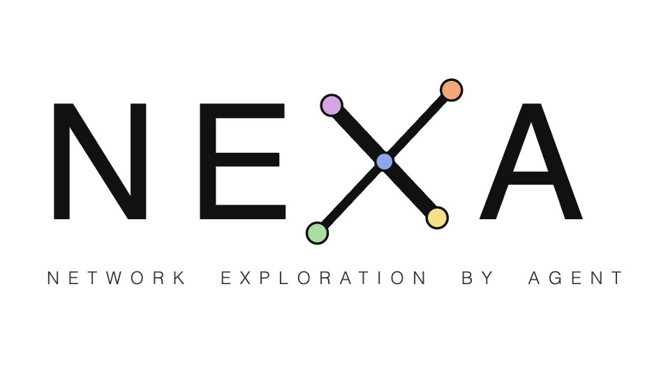

<p align="center">
  <picture>
    <source media="(prefers-color-scheme: dark)" srcset="assets/nexa_logo_dark.png">
    
  </picture>
</p>

# NEXA: An Inspectable Framework for Biomedical Knowledge Graph Exploration

NEXA is a framework for querying biomedical knowledge graphs using natural language. It provides a web interface that allows anyone to interact with Neo4j knowledge graphs through large language models. All answers are grounded in explicit Cypher queries with full transparency on retrieved data and reasoning steps, enabling verification, reproducibility, and reliable exploration of biomedical knowledge.

## Features

- **Two reasoning modes**: a fixed **Direct** pipeline and an autonomous **Flex** agent (see [Reasoning Modes](#reasoning-modes))
- **Multi-LLM Support**: OpenAI, Anthropic, Google Gemini, Azure OpenAI, and Ollama (local)
- **Knowledge Graph Integration**: Compatible with any Neo4j KG (pre-configured with Hetionet, AlzKB and PrimeKG)
- **Natural Language to Cypher**: Automatic translation of user questions into structured graph queries
- **Transparent Reasoning**: Answers include the generated Cypher query, the retrieved data, and the intermediate agent steps
- **Read-only Access**: Generated queries cannot modify the knowledge graph
- **Conversational Memory**: Persistent conversation history via PostgreSQL
- **Agent Presets**: Server-side system prompts and structured output schemas
- **REST API**: FastAPI backend for programmatic access
- **Web Interface**: Streamlit-based UI for interactive querying and configuration
- **Local Deployment**: Run the full system locally for data control and privacy

---

## Reasoning Modes

NEXA answers a question in one of two modes, selectable per conversation:

- **Direct**: a fixed pipeline that translates the question into a Cypher query, runs it, and corrects it if needed. Best for fast, focused questions.
- **Flex**: an autonomous agent that decides its own steps, such as exploring the graph, running several queries and combining their results. Best for more open or multi-step questions.

Select the mode in the sidebar of the web UI, or per request via the API `agent_mode` parameter (`direct` or `flex`).

---

## Quick Start (Docker)

### Prerequisites

- [Docker](https://docs.docker.com/get-docker/) and [Docker Compose](https://docs.docker.com/compose/install)
- Internet access for the first build, which downloads the three knowledge graphs from their publishers (about 1.3 GB)
- Free TCP ports: `7474`, `7475`, `7476`, `7687`, `7688`, `7689`, `5432` (databases), `8000` (API), `8501` (UI). On Linux the API and the UI run with host networking, so a port already in use aborts the startup with an explicit error.

### Installation

```bash
git clone https://github.com/mathieuarru/NEXA.git
cd NEXA

# Linux
docker compose -f docker-compose.linux.yml --profile full up -d

# Mac / Windows
docker compose --profile full up -d
```

This will start:

| Service | Ports | Description |
|---------|-------|-------------|
| Neo4j Hetionet | 7474 / 7687 | Biomedical knowledge graph |
| Neo4j AlzKB | 7475 / 7688 | Alzheimer's disease knowledge graph |
| Neo4j PrimeKG | 7476 / 7689 | Precision medicine knowledge graph |
| PostgreSQL | 5432 | Conversation memory (LangGraph checkpointer) + Flex result store |
| API | 8000 | FastAPI backend |
| Frontend | 8501 | Streamlit UI |

### First start

The first start takes a few minutes while the knowledge graphs are loaded. A graph is ready when its container shows `healthy`. Later starts are immediate.

```bash
# Linux
docker compose -f docker-compose.linux.yml ps
# Mac / Windows
docker compose ps
```

### Access

Open your browser at **http://localhost:8501**

### Configuration

1. Go to **Settings > API Keys** to enter your LLM API keys
2. Select a **KG Profile** (Hetionet, Alzkb 121, PrimeKG 21)
3. Choose your **LLM Provider** and **Model**, and the **reasoning mode** (Direct / Flex) in the sidebar

---

## Docker Compose Profiles

| Profile | Services | Linux | Mac / Windows |
|---------|----------|-------|---------------|
| `db` | Neo4j + PostgreSQL only | `docker compose -f docker-compose.linux.yml --profile db up -d` | `docker compose --profile db up -d` |
| `app` | API + Frontend only | `docker compose -f docker-compose.linux.yml --profile app up -d` | `docker compose --profile app up -d` |
| `full` | All services | `docker compose -f docker-compose.linux.yml --profile full up -d` | `docker compose --profile full up -d` |

---

## Manual Launch (Development)

If you prefer to run the databases in Docker and the application locally (requires Python 3.13 and [Poetry](https://python-poetry.org)):

```bash
# 1. Start databases only
# Linux:
docker compose -f docker-compose.linux.yml --profile db up -d
# Mac / Windows:
docker compose --profile db up -d

# 2. Install dependencies (if your default Python is not 3.13, run `poetry env use python3.13` first)
poetry install

# 3. Configure environment (copy the template and fill in keys / connection strings)
cp .env_example .env

# 4. Start the API
poetry run uvicorn nexa.api.agent_api:app --host 0.0.0.0 --port 8000

# 5. Start the frontend (in another terminal)
poetry run streamlit run nexa_frontend/app.py --server.port 8501
```

---

## Using Ollama (Local LLMs)

Ollama allows you to run LLMs locally without API keys.

```bash
# Install: https://ollama.com/download
# Pull a model
ollama pull qwen3:14b-q8_0
```

In the application, select **ollama** as the LLM Provider. No API key is required.

---

## API Keys

API keys can be configured in the UI (**Settings > API Keys**) or via a `.env` file (start from `.env_example`):

```env
OPENAI_API_KEY=sk-...
ANTHROPIC_API_KEY=sk-ant-...
GOOGLE_API_KEY=...
AZURE_API_KEY=...
AZURE_OPENAI_ENDPOINT=https://your-resource.openai.azure.com
```

Keys entered in the UI are session-scoped and override environment variables.

---

## Project Structure

```
NEXA/
├── nexa/                      # Core backend
│   ├── api/                   # FastAPI app (agent_api, profile_manager, stop_registry)
│   ├── config/                # Configuration (params.py)
│   ├── core/                  # Direct mode: NexaAgent pipeline + get_llm
│   ├── flex/                  # Flex mode: NexaFlex ReAct agent, graph, tool trace
│   ├── knowledge_graph/       # Neo4j access, read-only check, Cypher generation, query correction
│   ├── models/                # Prompts, dynamic few-shot examples, answer schemas, enums
│   ├── result_store/          # Flex result store (PostgreSQL) + schema.sql
│   ├── tools/                 # Flex agent tools (kg / result / output tools, schemas)
│   └── utils/                 # Logging, token budgeting, shared helpers
├── nexa_frontend/             # Streamlit frontend
│   ├── app.py                 # Main entry point
│   ├── chat_direct/           # Direct-mode chat page
│   ├── chat_flex/             # Flex-mode chat page (trace, data panel, graph view)
│   ├── api_utils.py           # Backend API client
│   ├── settings_page.py       # Settings (API keys, KG profiles, agent presets)
│   ├── ui_components.py       # Sidebar, streaming, shared components
│   └── state_manager.py       # Session state initialization
├── benchmark/                 # Benchmark runner, evaluator, baselines, datasets, results
├── figures/                   # Figure scripts
├── tests/                     # Unit tests and read-only integration check
├── api_data/                  # KG profiles, descriptions, presets, few-shot examples (runtime data)
├── assets/                    # Logos used by this README
├── alzkb/ · hetionet/ · primekg/   # Knowledge-graph download and import scripts
├── docker/                    # Container helpers (download check, read-only startup, healthcheck, port preflight)
├── docker-compose.yml         # Docker orchestration (+ docker-compose.linux.yml)
├── Dockerfile.api · Dockerfile.frontend · Dockerfile.hetionet · Dockerfile.alzkb121 · Dockerfile.primekg
├── .env_example               # Configuration template
└── pyproject.toml, poetry.lock   # Python dependencies (Poetry)
```

---

## API Documentation

When running, access the interactive API docs at:

- **Swagger UI**: http://localhost:8000/docs

---

## Citation

If you use NEXA in your research, please cite it.
